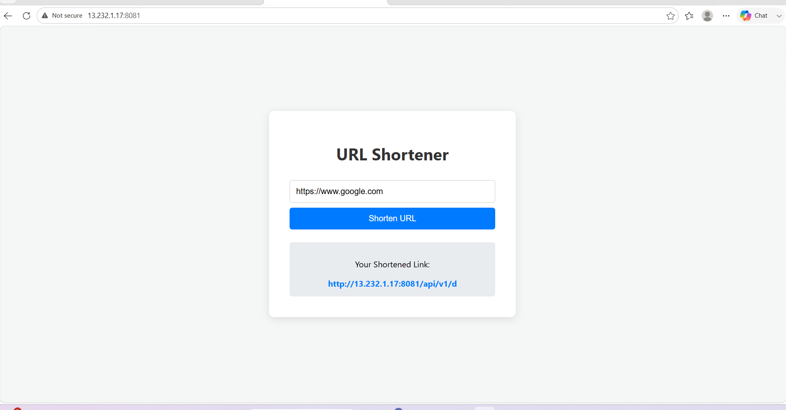
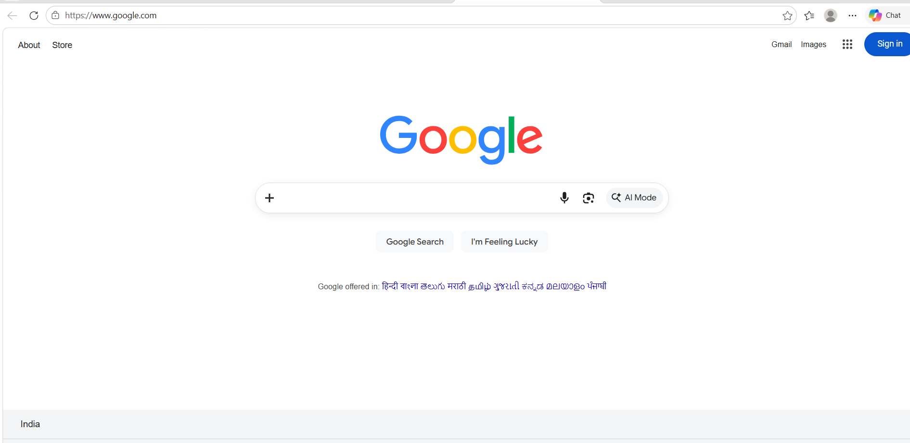
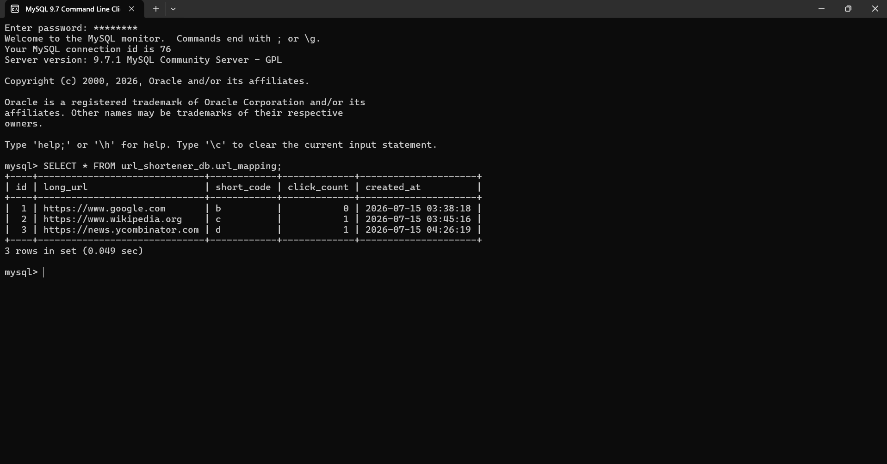
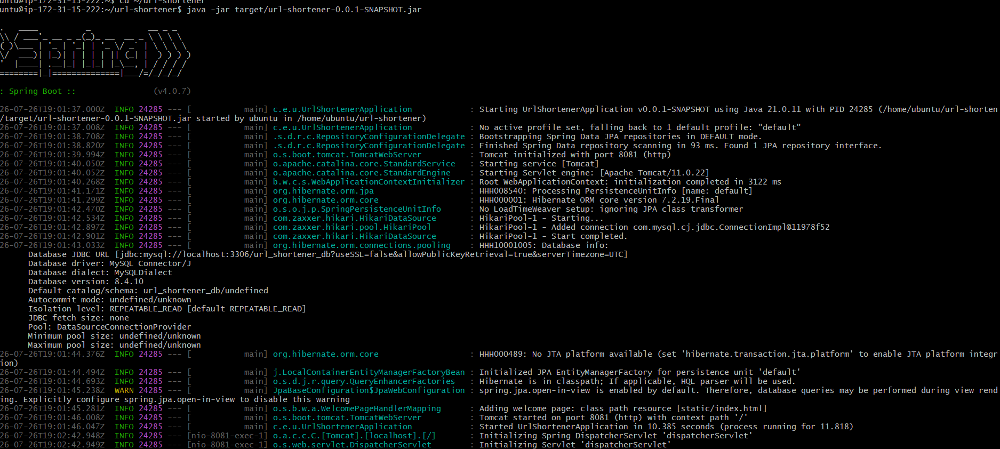

# 🔗 URL Shortener Service


A cloud-deployed **URL Shortener Service** built using **Java Spring Boot, MySQL, and AWS EC2**.

The application provides a simple and efficient way to convert long URLs into short URLs and redirect users to the original links. The backend application is deployed on an AWS EC2 Linux server with database connectivity and security configuration.

---

# 📌 Project Overview

The goal of this project was to build and deploy a real-world backend application with cloud infrastructure.

The application demonstrates:

- Backend API development using Spring Boot
- Database integration using MySQL
- Cloud deployment using AWS EC2
- Linux server management
- Security configuration using AWS Security Groups
- Version control using Git and GitHub

---

# 🚀 Live Deployment

The application is deployed on AWS EC2 and publicly accessible.

🌐 Application URL:

```
http://13.232.1.17:8081
```

---

# ✨ Features

## 🔗 URL Shortening

- Accepts long URLs from users
- Generates unique short URLs
- Stores URL mappings in MySQL database


## 🔄 URL Redirection

- Redirects users from short URL to original URL
- Handles URL mapping dynamically


## 🗄️ Database Management

- Persistent URL storage
- MySQL database integration
- JPA/Hibernate based database operations


## ☁️ Cloud Deployment

- Hosted on AWS EC2
- Linux-based deployment environment
- Public access configured through Security Groups

---

# 🏗️ System Architecture


```
                    User Browser
                         |
                         |
                         v

                AWS EC2 Instance
                         |
                         |
                         v

             Spring Boot Application
                         |
                         |
                         v

                    MySQL Database

```


---

# 🛠️ Technology Stack

## Backend

| Technology | Purpose |
|------------|---------|
| Java | Programming Language |
| Spring Boot | Backend Framework |
| Spring Data JPA | Database Operations |
| REST API | API Communication |
| Maven | Dependency Management |


## Database

| Technology | Purpose |
|------------|---------|
| MySQL | Data Storage |


## Cloud & DevOps

| Technology | Purpose |
|------------|---------|
| AWS EC2 | Application Hosting |
| IAM Role | Secure AWS Access |
| Security Groups | Network Security |
| Linux Ubuntu | Server Environment |
| SSH | Remote Server Management |
| Git/GitHub | Version Control |

---

# 📂 Project Structure


```
url-shortener/

│
├── src/
│   │
│   ├── main/
│   │   │
│   │   ├── java/
│   │   │
│   │   └── resources/
│
├── pom.xml
│
├── application.properties
│
├── README.md
│
└── screenshots/

```


---

# ⚙️ Local Installation & Setup


## 1. Clone Repository


```bash
git clone https://github.com/vivek65666/url-shortener.git
```


## 2. Navigate to Project


```bash
cd url-shortener
```


## 3. Configure Database


Update:

```
src/main/resources/application.properties
```


Example:


```properties
spring.datasource.url=jdbc:mysql://localhost:3306/urlshortener
spring.datasource.username=root
spring.datasource.password=password

spring.jpa.hibernate.ddl-auto=update
spring.jpa.show-sql=true
```


---

## 4. Build Application


```bash
mvn clean package
```


---

## 5. Run Application


```bash
java -jar target/url-shortener.jar
```


Application will start:

```
http://localhost:8081
```

---

# ☁️ AWS EC2 Deployment


## Deployment Process


### Step 1: Launch EC2 Instance

- Created AWS EC2 Ubuntu instance
- Configured SSH access


### Step 2: Install Required Software


Installed:

- Java
- MySQL
- Git


### Step 3: Upload Application


Transferred Spring Boot JAR file to EC2 server.


### Step 4: Start Application


```bash
java -jar url-shortener.jar
```


### Step 5: Configure Security Group


Allowed ports:


| Port | Purpose |
|------|---------|
| 22 | SSH |
| 8081 | Spring Boot Application |


---

# 🔐 AWS Security Configuration


Security Group Rules:


```
Inbound Rules

SSH       : 22
HTTP App  : 8081

```


Application is accessible from the internet through EC2 public IP.

---


## 📸 Screenshots

### Application Running


### URL Shortening Test


### Redirect Functionality


### AWS EC2 Deployment



---

# 🧪 Testing


## URL Creation Test


Request:

```
POST /api/url
```


Example:


```
Original URL:

https://www.google.com


Generated URL:

http://13.232.1.17:8081/abc123

```


---

## Redirect Test


Opening:


```
http://13.232.1.17:8081/abc123
```


Successfully redirects to:


```
https://www.google.com
```


---

# 📊 Deployment Status


| Component | Status |
|-----------|--------|
| Spring Boot Application | ✅ Completed |
| MySQL Database | ✅ Connected |
| AWS EC2 Deployment | ✅ Completed |
| Security Group Configuration | ✅ Completed |
| Public Access | ✅ Enabled |
| URL Shortening | ✅ Working |
| Redirect Feature | ✅ Working |
| GitHub Repository | ✅ Updated |

---

# 🚀 Future Enhancements


## DevOps Improvements

- Docker containerization
- Docker Compose deployment
- CI/CD pipeline using GitHub Actions
- Jenkins automation


## Cloud Improvements

- AWS Application Load Balancer
- Route 53 Domain Mapping
- HTTPS using SSL Certificate
- AWS CloudWatch Monitoring


## Application Improvements

- User authentication
- URL expiration
- Click analytics
- Redis caching
- API documentation using Swagger

---

# 🎯 Skills Demonstrated


This project demonstrates practical experience with:


✅ Java Backend Development  
✅ Spring Boot REST APIs  
✅ MySQL Database Integration  
✅ AWS EC2 Deployment  
✅ Linux Server Administration  
✅ Cloud Networking  
✅ Security Groups  
✅ Git Version Control  
✅ Application Deployment  


---

# 👨‍💻 Author


## Vivek C Raj


MCA Student | Aspiring DevOps & Cloud Engineer


GitHub:

https://github.com/vivek65666


LinkedIn:

https://linkedin.com/in/vivek-c-raj


---

⭐ If you find this project useful, consider giving it a star!
